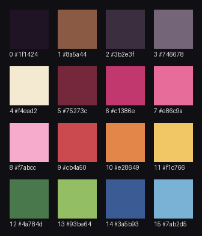

# Beast2D 16 palette

A soft, dusty, pink-centered retro palette for Beast2D, inspired by Pixel Vision 8.

| # | Hex | Name | Use it for |
|---|-----|------|------------|
| 0 | `#1f1424` | Plum Outline | Outlines, space background |
| 1 | `#8a5a44` | Dirt Brown | Dirt, wood, earth |
| 2 | `#3b2e3f` | Shadow | Shadows, dark UI |
| 3 | `#746678` | Stone Gray | Metal, stone, disabled UI |
| 4 | `#f4ead2` | Cream | Highlights, text, panels |
| 5 | `#75273c` | Deep Rose | Pink ramp shadow |
| 6 | `#c1386e` | Magenta | Pink ramp mid |
| 7 | `#e86c9a` | Hot Pink | Player/hero base, key UI |
| 8 | `#f7abcc` | Light Pink | Pink ramp highlight |
| 9 | `#cb4a50` | Red | Danger, damage, enemies |
| 10 | `#e28649` | Orange | Fire, explosions |
| 11 | `#f1c766` | Yellow | Coins, gems, pickups, UI accents |
| 12 | `#4a784d` | Moss Green | Dark foliage |
| 13 | `#93be64` | Leaf Green | Nature, health, success |
| 14 | `#3a5b93` | Blue | Water, ice, sky, fuel (dark) |
| 15 | `#7ab2d5` | Sky Blue | Water, ice, sky, fuel (light) |

## Rules

- Outline everything with color 0.
- Use color 0 for space and night backgrounds, too.
- Never use pure black or pure white; use 0 and 4 instead.
- Shade with the ramp step below (e.g. 8 → 7 → 6 → 5, 11 → 10, 13 → 12, 15 → 14).
- Keep pink (5–8) for the player and key UI.
- Use 1 (Dirt Brown) for dirt, wood, and earth.

## Files

- `docs/palette/beast2d-16.gpl`: GIMP/Aseprite palette
- `docs/palette/beast2d-16.hex`: one hex per line
- `docs/palette/beast2d-16.json`: `{"name": "Beast2D 16", "colors": [...]}`

**Aseprite:** open the palette menu (☰ above the palette panel) → *Load Palette…* → pick `docs/palette/beast2d-16.gpl`.
